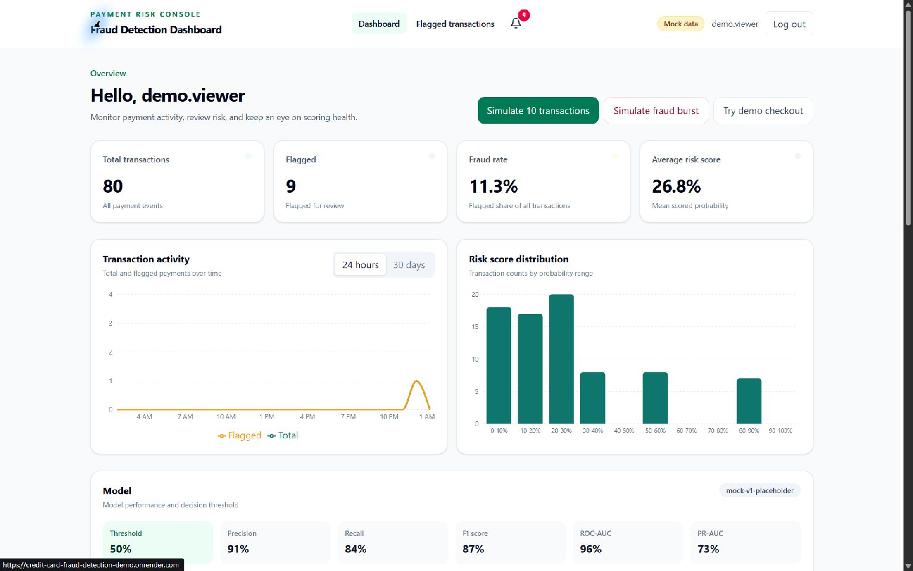
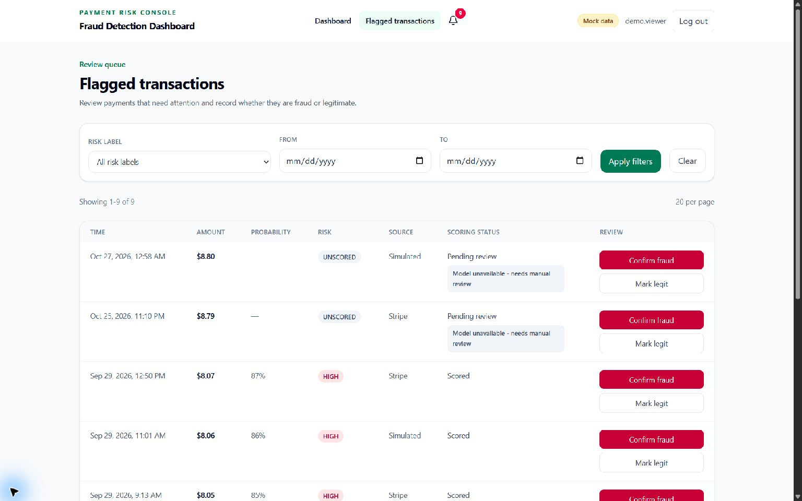

# Payment Risk Console

A full-stack credit-card fraud monitoring demo. Merchants can review transaction activity, inspect model risk scores, and manually review flagged payments from a single dashboard.

> **Demo mode:** The public site currently runs with mock data. Account actions, transactions, and checkout are simulated in the browser. No payment is processed, and mock model metrics are illustrative only.

## Live demo

[Open the dashboard](https://credit-card-fraud-detection-demo.onrender.com/)

The Render static site uses `VITE_USE_MOCK=true`, so it works without a live API, database, or payment provider.

## Screenshots

### Dashboard

The dashboard shows transaction totals, flagged activity, risk charts, model metrics, and demo actions.



### Flagged transactions

The review queue supports risk and date filters and lets a reviewer mark a transaction as fraud or legitimate. Unscored rows are labeled for manual review.



## What the project includes

- **React dashboard:** Login and registration screens, a protected overview page, a flagged-transaction review page, and a batch AI analysis screen.
- **Transaction monitoring:** KPI cards, a 24-hour/30-day activity chart, a risk-score histogram, and a transaction table that refreshes every five seconds.
- **Review workflow:** Filter and page through flagged payments, then record a fraud or legitimate decision. Transactions the model could not score are marked for manual review.
- **Model information:** Shows the model version, decision threshold, precision, recall, F1, ROC-AUC, PR-AUC, and confusion matrix.
- **Explainable AI:** Reviewers can inspect the strongest feature contributions behind a scored flag. XGBoost explanations use TreeSHAP; logistic regression uses exact coefficient contributions. Mock mode labels its examples clearly.
- **Batch AI analysis:** Upload a CSV and score up to 100 rows with the trained model. The analyzer ignores any `Class` label, returns only scores and risk labels, and does not save the uploaded rows.
- **Alerts:** A navbar bell shows the number of unread flagged transactions and refreshes every 15 seconds.
- **Mock mode:** An Axios adapter supplies in-memory demo responses while keeping the same API calls as the real backend. The public demo's checkout is only a confirmation message; no payment is processed.
- **Python API:** FastAPI, JWT authentication, MongoDB persistence, transaction queries/statistics, fraud scoring, explanations, simulation, review, alerts, and Razorpay test checkout plus verified webhooks.
- **Python ML service:** A FastAPI service loads the trained model artifacts and exposes health, model-info, single and batch prediction, and local explanation endpoints. The training pipeline compares four supervised approaches and an Isolation Forest baseline, selects a model and precision-aware threshold using validation data, and evaluates the held-out test set.

## How it is organized

| Folder | Purpose |
| --- | --- |
| `client/` | React 19, Vite, Tailwind CSS, Recharts, and the mock API adapter |
| `server/` | Active FastAPI API, MongoDB/PyMongo, JWT auth, fraud routes, and Razorpay payments. `server/legacy-express/` keeps the old Express version as a rollback reference. |
| `ml-service/` | FastAPI prediction service, model training scripts, tests, and saved model artifacts |
| `docs/API_CONTRACT.md` | The shared source of truth for API paths and JSON request/response shapes |

### Request flow

```text
React dashboard  ->  FastAPI API  ->  MongoDB
                           |        ->  FastAPI model service
                           |        ->  Razorpay test checkout / webhook
                           |
                    Axios mock adapter
                    (when VITE_USE_MOCK=true)
```

The mock adapter lets the frontend demo run before the API is available. Switch to real requests by setting `VITE_USE_MOCK=false` and configuring the API URL.

## Run the frontend demo locally

You need Node.js and npm. In PowerShell:

```powershell
cd client
npm install
Copy-Item .env.example .env
```

Edit `client/.env` to use mock mode:

```env
VITE_API_URL=http://localhost:5000
VITE_USE_MOCK=true
```

Then start Vite:

```powershell
npm run dev
```

Open the local URL printed by Vite (usually `http://localhost:5173`). In mock mode, registration accepts a password with at least 8 characters and no backend account is created. Demo transactions are generated by the mock API.

## Run the full stack locally

The full stack needs a MongoDB database, the Python API, the Python ML service, and Razorpay **test-mode** credentials to exercise checkout. Keep all secrets in local `.env` files; never commit them.

### 1. Start the ML service

Use Python 3.12 or newer, then from the repository root:

```powershell
cd ml-service
py -3.12 -m venv .venv
.\.venv\Scripts\Activate.ps1
python -m pip install -r requirements.txt
uvicorn app.main:app --reload --port 8000
```

The model file and metadata are under `ml-service/artifacts/`. The original training CSV is not included in the repository. See [the ML service guide](ml-service/README.md) to fetch or supply the dataset and reproduce training.

### 2. Configure and start the API

Copy `server/.env.example` to `server/.env` and fill in your own values:

```env
PORT=5000
MONGODB_URI=<your MongoDB connection string>
JWT_SECRET=<random secret with at least 32 characters>
CLIENT_URL=http://localhost:5173
ML_SERVICE_URL=http://localhost:8000
ML_TIMEOUT_MS=60000
RAZORPAY_KEY_ID=rzp_test_<your test key id>
RAZORPAY_KEY_SECRET=<your Razorpay test key secret>
RAZORPAY_WEBHOOK_SECRET=<your Razorpay test webhook secret>
ALLOW_LIVE_PAYMENTS=false
```

From inside `server/`, the copy command is `Copy-Item .env.example .env` in PowerShell.

`MONGODB_DATABASE` and `ML_API_KEY` are optional. Keep `ALLOW_LIVE_PAYMENTS=false` for this demo. Start the API in a separate terminal:

```powershell
cd server
py -3.12 -m venv .venv
.\.venv\Scripts\Activate.ps1
python -m pip install -r requirements.txt
uvicorn app.main:app --reload --port 5000
```

### 3. Point the client at the API

Set `VITE_API_URL=http://localhost:5000` and `VITE_USE_MOCK=false` in `client/.env`, then run `npm run dev` from `client/`. Restart Vite after changing environment variables.

## API reference

See [docs/API_CONTRACT.md](docs/API_CONTRACT.md) for the exact endpoints and JSON shapes. The main routes cover:

- Authentication: `/api/auth/register`, `/api/auth/login`, `/api/auth/me`
- Transactions: list, statistics, score histogram, simulation, and review under `/api/transactions`
- Payments: `/api/payments/checkout-session`
- Payment confirmation and webhooks: `/api/payments/verify`, `/api/webhooks/razorpay`
- Model and alerts: `/api/model-info` and `/api/alerts/unread-count`

## Deployment

The public demo is a Render **Static Site** built from `client/`:

- Root directory: `client`
- Build command: `npm install && npm run build`
- Publish directory: `dist`
- Environment variable: `VITE_USE_MOCK=true`

Deploying with mock mode keeps the public site independent of backend secrets and does not enable payments. For a real API connection, deploy the Python API from `server/` with start command `uvicorn app.main:app --host 0.0.0.0 --port $PORT`; configure MongoDB, JWT, client, ML, and Razorpay test secrets in the host dashboard. Then set the client's `VITE_API_URL` to the Python API URL and `VITE_USE_MOCK=false`. Configure the Razorpay **test-mode** webhook at `<API URL>/api/webhooks/razorpay` for `payment.captured`. Keep `ALLOW_LIVE_PAYMENTS=false` unless the project is approved for live payments and you intentionally switch credentials.
